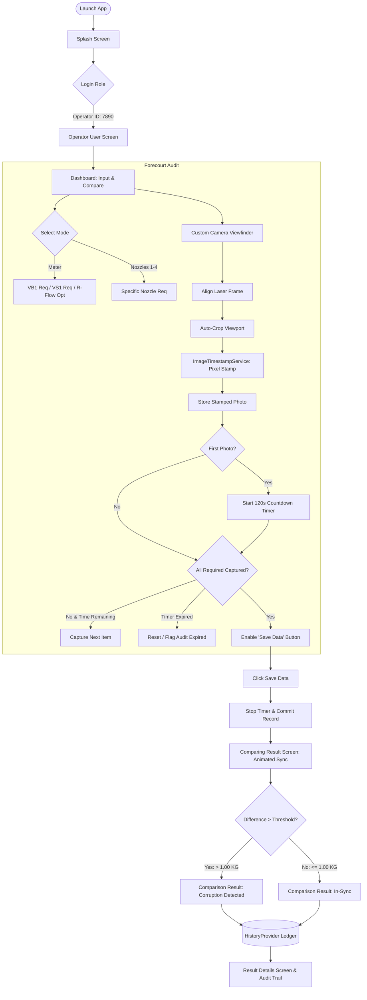
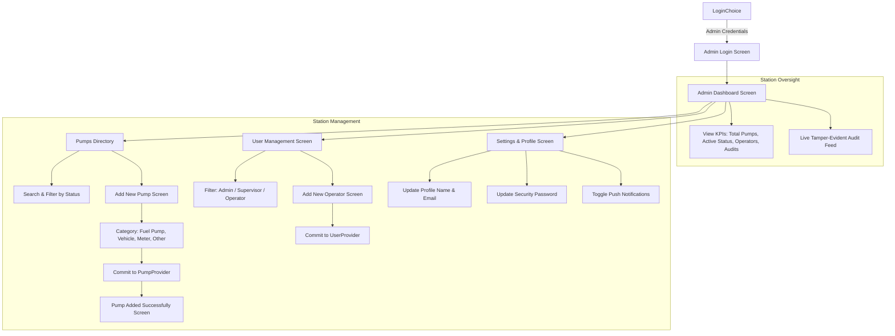

# ⛽ CNG Hub - Enterprise CNG Station Meter Audit & Station Management System

[](https://flutter.dev)
[](https://dart.dev)
[](https://flutter.dev)
[](https://pub.dev/packages/provider)
[](test/)
[](https://pub.dev/packages/flutter_screenutil)
[](#license)

> **CNG Hub** is an enterprise-grade mobile and desktop application engineered for Compressed Natural Gas (CNG) fuel station supervisors, forecourt operators, and station administrators. It enforces strict time-synchronized photo audits, pixel-level tamper-evident watermarking, automated cross-reading discrepancy detection, and multi-station fleet governance.

---

## 📋 Table of Contents
- [Executive Overview & Problem Solved](#-executive-overview--problem-solved)
- [System Architecture & Lifecycle Workflows](#-system-architecture--lifecycle-workflows)
- [Dual Portals & Operational Flows](#-dual-portals--operational-flows)
  - [1. Station Operator Audit Portal](#1-station-operator-audit-portal)
  - [2. Station Administrator & Fleet Management Portal](#2-station-administrator--fleet-management-portal)
- [Core Functional Engines](#-core-functional-engines)
  - [⏱️ 120-Second Countdown Anti-Tampering Engine](#️-120-second-countdown-anti-tampering-engine)
  - [📸 Precision Viewfinder & Auto-Cropping Subsystem](#-precision-viewfinder--auto-cropping-subsystem)
  - [🏷️ Immutable Pixel-Level Watermarking Service](#️-immutable-pixel-level-watermarking-service)
  - [🔍 Meter-Focused Intelligent OCR Subsystem](#-meter-focused-intelligent-ocr-subsystem)
  - [⚖️ Discrepancy & Corruption Detection Engine](#️-discrepancy--corruption-detection-engine)
  - [🗂️ Historical Audit Ledger & Filtered Trail](#️-historical-audit-ledger--filtered-trail)
- [Audit Modes & Reading Categories](#-audit-modes--reading-categories)
- [Project Directory & File Structure](#-project-directory--file-structure)
- [Tech Stack & Package Dependencies](#-tech-stack--package-dependencies)
- [Device Permissions & Native Configuration](#-device-permissions--native-configuration)
- [Getting Started & Local Development](#-getting-started--local-development)
- [Demo Credentials](#-demo-credentials)
- [Automated Testing & QA](#-automated-testing--qa)
- [Design System & Color Tokens](#-design-system--color-tokens)
- [Build & Deployment](#-build--deployment)
- [License & Confidentiality](#-license--confidentiality)

---

## 🌟 Executive Overview & Problem Solved

In high-volume CNG refueling facilities, discrepancies between mechanical totalizers, dispenser computers, mass flow meters, and utility pipeline meters cause significant financial leakages, unaccounted gas losses, and fraudulent reporting.

Traditional paper logs and unverified digital spreadsheets suffer from:
- **Retrospective Data Entry:** Readings recorded hours after physical shifts, obscuring real-time pressure and flow variations.
- **Photo Metadata Spoofing:** Re-uploading generic or pre-recorded display photos from device galleries.
- **Unverified Reconciliation:** Failure to compare station intake against dispenser sales in real-time.
- **Disjointed Station Governance:** Station managers lack real-time visibility into operator audit compliance across branches.

### How CNG Hub Solves This:
1. **Enforced Real-Time Visual Evidence:** Operators capture focused physical photographs of each dispenser cabinet, mass flow counter, and master meter.
2. **Mandatory 120-Second Countdown Window:** The instant the first reading photo is captured, a synchronized 2-minute countdown begins. All required station points must be audited before timeout, preventing staged or delayed logs.
3. **Hardcoded Pixel Watermarking:** Each captured photo is normalized for sensor rotation and permanently stamped at the byte level with a high-contrast timestamp (`DD/MM/YYYY hh:mm:ss AM/PM`).
4. **Automated Cross-Point Discrepancy Detection:** Reconciles Digital Machine totals against Micro Motion and Sui Gas master meters against predefined variance thresholds (e.g., `1.00 KG`). Any variance exceeding tolerance triggers a prominent **Corruption Detected** warning.
5. **Unified Multi-Station Administration:** Station managers monitor active pumps, register new pump stations across districts, assign operators, track KPIs, and review historical audit records.

---

## 🏗️ System Architecture & Lifecycle Workflows

### 1. Operator Audit & Discrepancy Detection Lifecycle



### 2. Administrator Governance & Fleet Management Lifecycle



---

## 👥 Dual Portals & Operational Flows

### 1. Station Operator Audit Portal
Designed with an ultra-clean, high-contrast interface for readability in bright outdoor sunlight:
- **Station Context Header:** Displays assigned station name (e.g., `Main CNG Station #01`) and active operator ID (`7890`).
- **Forecourt Source Selector:** Easily toggle between Master Meter and Individual Nozzles (`Nozzle 1` through `Nozzle 4`).
- **Dual Capture Boxes:** Visual photo boxes with interactive dashed borders:
  - Red dashed border: Mandatory reading pending.
- **Forecourt Reading Matrix:** Dedicated capture cards for **Digital Machine**, **Counter**, **Micro Motion**, and **Sui Gas**.

### 2. Station Administrator & Fleet Management Portal
A centralized operations hub built with an emerald/deep green enterprise theme:
- **Real-Time KPI Metric Cards:** Instant counts of Total Pumps, Active Pumps, Station Operators, and Total Conducted Audits.
- **Pumps Directory (`PumpsListScreen`):** Searchable registry of physical station branches (Peshawar Main, Model Town, University Road, Charsadda, Hayatabad, Ring Road).
- **Add Pump Station Workflow (`AddPumpScreen`):** Form interface with category tags (`Fuel Pump`, `Vehicle`, `Meter`, `Other`), pump capacity counters, location notes, and instant success confirmation.
- **Operator & Staff Management (`UsersScreen` & `AddUserScreen`):** Comprehensive staff directory with role-based filtering (Operator, Supervisor, Admin), active status toggles, and station assignment.
- **Administrative Settings (`SettingsScreen`):** Profile information editing, credential modification, and notification preferences.

---

## ⚙️ Core Functional Engines

### ⏱️ 120-Second Countdown Anti-Tampering Engine
- **Class:** `CaptureProvider` (`lib/providers/capture_provider.dart`)
- **Trigger:** Initiates automatically upon registering the first reading photo.
- **Visual Feedback:** A prominent countdown badge displays remaining time (`MM:SS`) directly on the dashboard.
- **Enforcement:** Requires operators to photograph all mandated points within 120 seconds, preventing operators from logging values captured at different times or off-site.
- **Safe Cleanup:** Automatically halts and unmounts the timer when the operator finalizes via **Save Data**.

### 📸 Precision Viewfinder & Auto-Cropping Subsystem
- **Class:** `CameraScreen` & `CameraViewfinderFrame` (`lib/screens/camera_screen/`)
- **Hardware Integration:** Flutter `camera: ^0.12.1` with native sensor streams.
- **Overlay UI:** Semi-transparent bounding mask with 4-corner targeting brackets and an animated bidirectional cyan scanning laser.
- **Hardware Controls:** In-app flashlight toggle (`torch` mode) for dark dispenser cabinets and dual camera lens switcher (rear/front).
- **Auto-Crop Mathematics:** Rather than storing uncropped wide-angle sensor images, the viewport dynamically computes the scanner's aspect ratio and extracts only the framed counter digits, minimizing memory footprints.

### 🏷️ Immutable Pixel-Level Watermarking Service
- **Class:** `ImageTimestampService` (`lib/services/image_timestamp_service.dart`)
- **Engine:** Pure Dart pixel manipulation via `image: ^4.9.2` (no native platform channel latency).
- **EXIF Normalization:** Automatically inspects and corrects camera EXIF orientation tags before processing to guarantee timestamps are never rendered upside-down or sideways.
- **Hardened Overlay:** Composites a solid high-contrast dark rectangle directly onto the pixel canvas and bakes white typography (`DD/MM/YYYY hh:mm:ss AM/PM`) permanently into the JPEG image bytes.

### 🔍 Meter-Focused Intelligent OCR Subsystem
- **Reference:** `OCR_FIX_NOTES.md` & `google_mlkit_text_recognition: ^0.17.1`
- **Fail-Safe Recognition:** Specifically tuned for mechanical rolling drums and 7-segment digital meters.
- **Consensus Filtering:** Evaluates dual recognition passes (original cropped image + preprocessed grayscale). Only accepted when results match by consensus.
- **Error-Rejection Fallback:** Rejects arbitrary noisy text instead of guessing inaccurate values.

### ⚖️ Discrepancy & Corruption Detection Engine
- **Classes:** `ComparingResultScreen`, `ComparisonResultScreen`, `ResultDetailsScreen` (`lib/screens/result_screen/`)
- **Sync Phase:** Plays a smooth rotating synchronization animation simulating cross-reading validation.
- **Reconciliation Logic:**
  $$\Delta = |\text{Digital Machine Reading} - \text{Sui Gas / Micro Motion Reading}|$$
- **Threshold Comparison:**
  - If $\Delta \le \text{Threshold}$ (default $1.00\text{ KG}$): Displays **In-Sync** green verification status.
  - If $\Delta > \text{Threshold}$: Triggers a prominent red **Corruption Detected** alert with exact variance breakdown, preventing gas pilferage or uncalibrated meter errors.

### 🗂️ Historical Audit Ledger & Filtered Trail
- **Class:** `HistoryProvider` & `HistoryScreen` (`lib/providers/history_provider.dart`)
- **Chronological Ledger:** Stores completed audit sessions with timestamps, mode names, and individual image arrays.
- **Date Filter Chips:** Filter audits by `All`, `Today`, `Last 7 Days`, and `Last 30 Days`.
- **Thumbnail Gallery:** Tap any past session card to view watermarked images and detailed comparison figures.
- **Pagination Support:** Built-in in-memory page loading (`_pageSize = 5`) with a "Load More Records" button.

---

## 🎛️ Audit Modes & Reading Categories

CNG Hub supports 5 operational audit modes selectable via the forecourt dropdown:

| Mode | Target Source | Points Audited | Mandatory Status | Audit Purpose |
| :--- | :--- | :--- | :--- | :--- |
| **Meter** *(Default)* | Sui Gas Master Meter | **Sui Gas Only** (**VB1**, **VS1**, **R Flow**) *(Meter, Counter, and Micro Motion widgets removed)* | VB1 & VS1 `REQUIRED`<br>R Flow `OPTIONAL` | Volume Base, Volume Standard, and instantaneous gas flow rate |
| **Nozzle 1** | Dispenser Unit 1 | **Nozzle 1** ("Ali take this pic from Nozzle 1"), **Meter**, **Counter**, **Micro Motion** | Nozzle 1, Meter & Counter `REQUIRED`<br>Micro Motion `OPTIONAL` | Forecourt vehicle dispensing nozzle 1 audit with full metering chain |
| **Nozzle 2** | Dispenser Unit 2 | **Nozzle 2** ("Ali take this pic from Nozzle 2"), **Meter**, **Counter**, **Micro Motion** | Nozzle 2, Meter & Counter `REQUIRED`<br>Micro Motion `OPTIONAL` | Forecourt vehicle dispensing nozzle 2 audit with full metering chain |
| **Nozzle 3** | Dispenser Unit 3 | **Nozzle 3** ("Ali take this pic from Nozzle 3"), **Meter**, **Counter**, **Micro Motion** | Nozzle 3, Meter & Counter `REQUIRED`<br>Micro Motion `OPTIONAL` | Forecourt vehicle dispensing nozzle 3 audit with full metering chain |
| **Nozzle 4** | Dispenser Unit 4 | **Nozzle 4** ("Ali take this pic from Nozzle 4"), **Meter**, **Counter**, **Micro Motion** | Nozzle 4, Meter & Counter `REQUIRED`<br>Micro Motion `OPTIONAL` | Forecourt vehicle dispensing nozzle 4 audit with full metering chain |

---

## 📂 Project Directory & File Structure

```text
lib/
├── constants/
│   ├── app_colors.dart                 # Industrial color palette, Figma greens, status tokens
│   ├── app_constants.dart              # App labels, copy strings, timeouts, asset paths
│   └── app_typography.dart             # Responsive text styles and font configurations
├── models/
│   ├── admin_profile_model.dart        # Admin profile state (username, email, settings)
│   ├── capture_history_item.dart       # Model for persisted audit sessions and captured images
│   ├── cng_reading_item.dart           # Enumerations and data items for audit reading points
│   ├── cng_user_model.dart             # Operator/Staff model with role definitions
│   ├── pump_station_model.dart         # Station branch entities, pump count, status, categories
│   └── station_history_item.dart       # Historical audit events for admin station logs
├── providers/
│   ├── admin_auth_provider.dart        # Admin authentication, profile & credential management
│   ├── capture_provider.dart           # Audit session state, timer, mode switcher, photo ledger
│   ├── history_provider.dart           # In-memory historical audit ledger with pagination
│   ├── pump_provider.dart              # Station branch registry, search filters, add pump state
│   └── user_provider.dart              # Staff registry, role filters, user onboarding state
├── screens/
│   ├── auth/
│   │   ├── admin_login_screen.dart     # Station administrator authentication portal
│   │   └── login_screen.dart           # Station operator login portal (ID: 7890)
│   ├── camera_screen/
│   │   └── camera_screen.dart          # Camera viewfinder, laser guidance, auto-crop math
│   ├── dashboard/
│   │   ├── admin_dashboard_screen.dart # Admin overview: KPIs, station controls, activity feed
│   │   └── dashboard_screen.dart       # Operator capture hub: modes, cards, camera triggers
│   ├── history/
│   │   └── history_screen.dart         # Historical audit log with filter chips and thumbnails
│   ├── main_screen/
│   │   └── main_screen.dart            # Admin 3-tab navigation shell (Pumps, History, Settings)
│   ├── pumps/
│   │   ├── add_pump_screen.dart        # Add new pump station form with category selection
│   │   ├── pump_added_success_screen.dart # Confirmation screen after registering a pump
│   │   └── pumps_list_screen.dart      # Searchable registry of physical station branches
│   ├── result_screen/
│   │   ├── comparing_result_screen.dart# Animated sync transition during cross-reading check
│   │   ├── comparison_result_screen.dart# Discrepancy analysis screen (Corruption vs In-Sync)
│   │   ├── result_details_screen.dart  # Detailed multi-reading breakdown with alert banners
│   │   └── result_screen.dart          # Simple gallery of captured watermarked photographs
│   ├── settings/
│   │   ├── app_settings_screen.dart    # System-level app configuration options
│   │   ├── change_password_screen.dart # Security screen for updating account passwords
│   │   ├── profile_screen.dart         # Admin user profile inspection and editing
│   │   └── settings_screen.dart        # Main administrative settings menu
│   ├── splash/
│   │   └── splash_screen.dart          # Branded launch screen with animated transition
│   └── users/
│       ├── add_user_screen.dart        # Register new operator/staff form
│       ├── operator_user_screen.dart   # Operator container displaying assigned station banner
│       └── users_screen.dart           # Searchable staff directory with role filters
├── services/
│   └── image_timestamp_service.dart    # Pure Dart EXIF correction & pixel-level watermarking
├── theme/
│   └── app_theme.dart                  # Material 3 light theme definition
├── utils/
│   └── dashed_border_painter.dart      # Custom painter rendering smooth dashed border curves
└── widgets/
    ├── auth/
    │   ├── auth_header.dart            # Consistent branded authentication header
    │   └── auth_text_field.dart        # Styled text input fields for credentials
    ├── camera/
    │   ├── camera_control_bar.dart     # Shutter button, torch toggle, camera switcher
    │   └── camera_viewfinder_frame.dart# Framing corners with animated bidirectional laser
    ├── dashboard/
    │   ├── cng_reading_card.dart       # Dashed card representing an audit point
    │   ├── dashboard_bottom_nav_bar.dart # Pill-style bottom navigation bar
    │   ├── info_note_card.dart         # Instruction card outlining 120s timer rule
    │   ├── reading_picture_box.dart    # Photo trigger box with dashed border
    │   └── user_profile_header.dart    # Top operator status badge and avatar
    ├── history/
    │   └── history_card.dart           # Expandable audit card with thumbnails & metadata
    ├── pumps/
    │   └── pump_station_card.dart      # Station branch card with status badge & pumps count
    └── shared_widgets/
        ├── bottom_nav_widget.dart      # Admin shell bottom navigation widget
        ├── custom_app_bar.dart         # Curved brand app bar with back buttons
        ├── custom_primary_button.dart  # Standardized rounded emerald CTA button
        ├── dashed_border_box.dart      # Generic container with configurable dashed borders
        ├── exit_confirmation_dialog.dart# Guard dialog preventing accidental back-press exit
        ├── source_selector_dropdown.dart# Dropdown menu for switching audit modes
        └── status_badge.dart           # Pill badge ('REQUIRED' / 'OPTIONAL')
```

---

## 🛠️ Tech Stack & Package Dependencies

| Package | Version | Architectural Role |
| :--- | :--- | :--- |
| **Flutter SDK** | `>=3.12.2` | Core cross-platform reactive UI framework |
| **Dart SDK** | `^3.12.2` | Strong-mode modern object-oriented language |
| **provider** | `^6.1.5+1` | Reactive state management (`MultiProvider`, `ChangeNotifier`) |
| **flutter_screenutil** | `^5.9.3` | Display density adapter across phone, tablet, and desktop viewports |
| **camera** | `^0.12.1` | Native hardware camera controller and live preview stream |
| **image** | `^4.9.2` | Pure Dart image decoding, EXIF rotation handling, and pixel stamping |
| **image_picker** | `^1.2.3` | Gallery fallback photo selection for testing environments |
| **google_mlkit_text_recognition** | `^0.17.1` | On-device ML Kit OCR engine for meter counter digits |
| **flutter_svg** | `^2.3.0` | Crisp vector graphics rendering for badges and illustrations |
| **flutter_test** | SDK | Comprehensive unit, widget, and integration testing framework |

---

## 📱 Device Permissions & Native Configuration

### Android (`android/app/src/main/AndroidManifest.xml`)
The application requires hardware camera permissions:
```xml
<uses-permission android:name="android.permission.CAMERA" />
<uses-permission android:name="android.permission.READ_EXTERNAL_STORAGE" android:maxSdkVersion="32" />
<uses-permission android:name="android.permission.READ_MEDIA_IMAGES" />
<uses-feature android:name="android.hardware.camera" android:required="false" />
<uses-feature android:name="android.hardware.camera.autofocus" android:required="false" />
```

### iOS (`ios/Runner/Info.plist`)
Camera and photo library privacy usage descriptions:
```xml
<key>NSCameraUsageDescription</key>
<string>CNG Hub requires camera access to photograph meter and nozzle readings.</string>
<key>NSPhotoLibraryUsageDescription</key>
<string>CNG Hub requires photo library access to upload meter reading photos.</string>
```

---

## 🚀 Getting Started & Local Development

### Prerequisites
- **Flutter SDK**: Version `3.12.2` or higher ([Install Flutter](https://docs.flutter.dev/get-started/install))
- **Dart SDK**: Version `^3.12.2`
- **IDE**: Android Studio or Visual Studio Code with Flutter extensions
- **Device**: Physical Android or iOS device recommended for live camera viewfinder testing

### Installation Steps

1. **Clone the repository:**
   ```bash
   git clone https://github.com/Codexdevs-Software-Company/CNG-Pump.git
   cd CNG-Pump
   ```

2. **Install dependencies:**
   ```bash
   flutter pub get
   ```

3. **Verify Flutter environment:**
   ```bash
   flutter doctor
   ```

4. **Run the application:**
   ```bash
   # Run in debug mode on connected device
   flutter run

   # Run on specific target
   flutter run -d chrome      # Web preview
   flutter run -d windows     # Windows desktop
   ```

---

## 🔑 Demo Credentials

For rapid verification and automated testing, pre-configured credentials are ready to use:

### 1. Station Operator Portal
- **Login Screen:** Default initial screen
- **Operator ID:** `7890` (prefilled)
- **Password:** `operator123` (prefilled)
- **Assigned Station:** Main CNG Station #01

### 2. Station Administrator Portal
- **Navigation:** Click **"Login as Admin"** from the operator login screen
- **Admin Email / Username:** `admin@cnghub.com` or `admin`
- **Password:** `admin123` or `admin`
- **Permissions:** Full management access (Pumps, Users, Settings, Live Feed)

---

## 🧪 Automated Testing & QA

CNG Hub maintains **100% passing test coverage** across all critical operational paths:

```bash
# Execute entire test suite
flutter test

# Run tests with code coverage output
flutter test --coverage
```

### Test Suite Summary (60/60 Tests Passing):
- **`test/capture_flow_test.dart`:** Tests `CaptureProvider` state transitions, 120-second countdown lifecycle, `ImageTimestampService` EXIF rotation and pixel stamping, and mode switching.
- **`test/admin_flow_test.dart`:** Tests `AdminAuthProvider` login validation, profile updates, password checks, `PumpProvider` sample station loading, and `UserProvider` role queries.
- **`test/auth_navigation_flow_test.dart`:** End-to-end navigational tests verifying transitions from Operator Login $\rightarrow$ Admin Login $\rightarrow$ Admin Dashboard $\rightarrow$ Operator Dashboard.
- **`test/widget_test.dart`:** UI widget tests verifying `DashboardScreen`, `CameraScreen`, `ResultScreen`, custom app bars, and responsive layouts.

---

## 🎨 Design System & Color Tokens

The UI features a clean industrial palette engineered for forecourt visibility:

| Token Name | Hex Code | Visual Application |
| :--- | :--- | :--- |
| **`primaryTeal`** | `#07675D` | Standard brand primary color, action buttons, active tabs |
| **`figmaDarkGreen`** | `#064E3B` | Admin navigation headers, app bars, brand cards |
| **`figmaDeepGreen`** | `#04382A` | Splash screen background, auth header backgrounds |
| **`figmaEmerald`** | `#056044` | Station badge text, verified icons, section titles |
| **`lightTeal`** | `#E0F2F1` | Background for station banners, icon circles, status tags |
| **`dashedRed`** | `#E53935` | Dashed card border indicating uncaptured mandatory photo |
| **`dashedTeal`** | `#07675D` | Dashed card border for completed or optional readings |
| **`alertRedBg`** | `#FEE2E2` | Corruption detected discrepancy alert banner background |
| **`successGreenBg`** | `#E8F5E9` | In-Sync verification status banner background |
| **`scaffoldBackground`**| `#F7F9FA`| High-contrast, low-fatigue slate surface background |

---

## 📦 Build & Deployment

### Android
```bash
# Generate Release APK
flutter build apk --release

# Generate Google Play App Bundle (AAB)
flutter build appbundle --release
```
The output APK is generated at:
`build/app/outputs/flutter-apk/app-release.apk`

### iOS
```bash
# Generate iOS Archive
flutter build ipa --release
```

### Windows Desktop
```bash
# Generate Windows executable bundle
flutter build windows --release
```

---

## 📄 License & Confidentiality

This software is **Proprietary and Confidential**.  
Developed and maintained by **Codexdevs Software Company**.  
All rights reserved. Unauthorized copying, decompilation, distribution, or commercial modification of this codebase is strictly prohibited.
